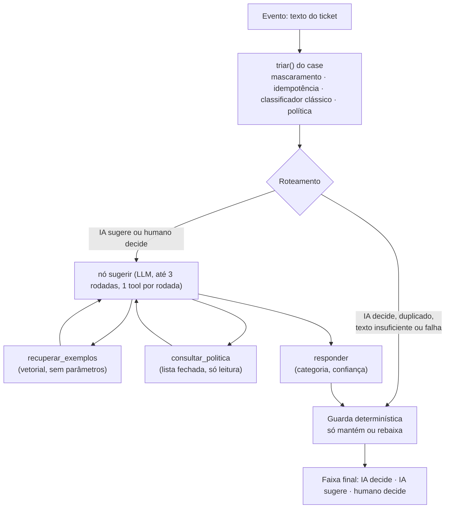

# triagem-tickets-rag-agente

Extensão pessoal do case técnico do G4 (PR #228): RAG, busca híbrida e agente com tool calling, medidos contra
baseline e controle.

- **O que é:** RAG (LangChain + pgvector), busca híbrida (full-text do Postgres + vetorial, fusão RRF) e um agente LangGraph com tool calling, cada um comparado com baseline e controle no holdout do case.
- **Stack:** Python · LangChain · LangGraph · Claude API · Postgres/pgvector · Docker · pytest.
- **Principais achados:** com vizinhos da busca híbrida, o LLM passa de 23,75% (exemplos aleatórios) para 45,25% (+21,5 pp), mas o voto desses vizinhos sem LLM (54,75%) e o classificador clássico (69,50%) acertam mais; a busca híbrida recupera pior que a vetorial; o agente não promoveu nenhum ticket indevidamente (0 em 1.271 execuções, por construção).

O agente **não é recomendado para produção**. Ele existe para medir a Q3. Em acurácia, o classificador clássico é
melhor que qualquer variante com LLM (Q1), e quase todo rebaixamento do agente foi alarme falso (6 de 7, n pequeno).

- PR do case: https://github.com/Gestao-Quatro-Ponto-Zero/ai-master-challenge/pull/228
- Este repositório **não faz parte da submissão ao G4**.

**Onde estão os critérios:**

- **Escopo, hipóteses e critérios de Q1:** em [`docs/planning/F0-escopo.md`](docs/planning/F0-escopo.md), commitado (`6dc8e3b`) antes de qualquer resultado de LLM.
- **Regras de cada fase:** nas specs de [`docs/planning/`](docs/planning/), commitadas junto com os resultados da fase. O git não prova que a spec veio antes da execução dentro da fase.
- **Mudanças de critério entre a F0 e a execução:** em [`docs/decisoes.md`](docs/decisoes.md) ("Critérios: o que mudou entre a F0 e a execução").

**De onde vêm os números:**

- **números medidos aqui:** de um arquivo de `results/` ou de [`docs/custos.md`](docs/custos.md), indicado na legenda;
- **números do case:** citam o PR #228 ou o arquivo copiado do case;
- **números tirados de reports de fase:** citam o report.

## 1. As 3 respostas, em números

### Q1 — Exemplos recuperados (RAG) melhoram o LLM na faixa de dúvida?

**Veredicto pré-registrado:**

- **RAG ajuda: sim.**
- **O LLM agrega: não.**
- **Vale para produção: não.**

Os exemplos recuperados por similaridade melhoram muito o LLM, mas o LLM com esses vizinhos acerta menos que o voto
majoritário dos mesmos vizinhos, e menos ainda que o classificador clássico.

Amostra: os mesmos 400 tickets do case (holdout por grupo, `p_max < 0,74`), modelo `claude-haiku-5-5`, uma rodada por variante.

| Variante | O que é | Acertos | Acurácia | Wilson 95% | Macro-F1 | Custo / 1.000 tickets | Latência p50 | Latência p95 |
|---|---|---|---|---|---|---|---|---|
| V0 | prompt do case, 8 exemplos fixos | 104/400 | 26,00% | 21,94–30,51% | 0,2577 | US$ 0,1503 | 1.087,0 ms | 1.458,0 ms |
| V1 | 5 exemplos aleatórios do treino | 95/400 | 23,75% | 19,84–28,16% | 0,2231 | US$ 0,1081 | 985,1 ms | 1.553,1 ms |
| V2 | 5 vizinhos da busca vetorial | 191/400 | 47,75% | 42,90–52,64% | 0,4693 | US$ 0,1100 | 987,1 ms | 1.248,2 ms |
| V3 | 5 vizinhos da busca híbrida (RRF) | 181/400 | 45,25% | 40,44–50,15% | 0,4505 | US$ 0,0886 | 988,2 ms | 1.479,4 ms |
| K1 | voto majoritário dos 5 vizinhos híbridos, sem LLM | 219/400 | 54,75% | 49,85–59,56% | 0,5128 | — | — | — |
| C | classificador clássico do case | 278/400 | 69,50% | 64,82–73,81% | 0,7095 | — | — | — |

*Fonte: [`results/f3/metricas_f3.json`](results/f3/metricas_f3.json) (gerado por `scripts/f3_familia.py`), que também
traz a matriz de confusão de cada variante (`matriz_confusao`: 8 linhas de rótulo × 9 colunas, as 8 categorias mais
`falha`).*

**Família pré-registrada:** McNemar exato pareado, com correção de Holm sobre as 4 comparações. É a única tabela de
comparações de Q1.

| Comparação | Diferença | b | c | p bruto | p de Holm |
|---|---|---|---|---|---|
| V3 × V1 (primária) | +21,50 pp | 100 | 14 | 3,49e-17 | 1,40e-16 |
| V3 × K1 | −9,50 pp | 38 | 76 | 4,75e-04 | 9,50e-04 |
| V3 × C | −24,25 pp | 37 | 134 | 4,14e-14 | 1,24e-13 |
| V2 × V3 | +2,50 pp | 33 | 23 | 2,29e-01 | 2,29e-01 |

*Fonte: `results/f3/familia_q1.csv`. b = A acerta e B erra; c = B acerta e A erra.*

**Os três critérios** (`results/f3/veredictos.json`):

- "RAG ajuda" exige V3 > V1 com p de Holm < 0,05: atendido.
- "O LLM agrega" exige V3 > K1 com p de Holm < 0,05: não atendido. V3 fica **abaixo** de K1.
- "Vale para produção" exige acurácia de V3 ≥ C: não atendido.

### Q2 — A busca híbrida recupera vizinhos melhores que a busca só vetorial?

**Veredicto: não.** A regra exigia o IC de (híbrida − vetorial) em precisão@5 inteiro acima de 0. Nos dois
universos, o IC fica inteiro **abaixo** de 0. A busca vetorial sozinha recupera melhor.

A F0 só tinha a hipótese; a regra de decisão entrou na spec da F3. O resultado é negativo e a regra não o favorece,
mas ela **não é pré-registro verificável** (ver [`docs/decisoes.md`](docs/decisoes.md)).

Os dois universos ficam lado a lado e não se misturam: a amostra de 2.000 é aleatória simples do holdout por grupo
(seed 42) e cobre todas as faixas do clássico; o recorte dos 400 cobre só a faixa de dúvida.

| Recuperador | Precisão@5, amostra de 2.000 | Acurácia K1, amostra de 2.000 | Precisão@5, recorte dos 400 | Acurácia K1, recorte dos 400 |
|---|---|---|---|---|
| Vetorial | 0,7406 (0,7264–0,7546) | 80,30% | 0,5145 (0,4820–0,5465) | 58,75% |
| Full-text | 0,5388 (0,5233–0,5543) | 61,25% | 0,3565 (0,3270–0,3890) | 41,25% |
| Híbrida (RRF) | 0,6892 (0,6748–0,7030) | 77,10% | 0,4780 (0,4470–0,5090) | 54,75% |

*Fonte: `results/f3/q2_recuperacao.json` (gerado por `scripts/f3_recuperacao.py`). IC 95% por bootstrap percentil, 2.000 reamostragens, seed 42. Nenhuma consulta full-text ficou sem resultado.*

| Diferença pareada | Precisão@5, amostra | K1, amostra | Precisão@5, recorte | K1, recorte |
|---|---|---|---|---|
| Híbrida − vetorial | -0,0514 (-0,0616 a -0,0418) | -0,0320 (-0,0490 a -0,0155) | -0,0365 (-0,0645 a -0,0090) | -0,0400 (-0,0875 a 0,0100) |
| Híbrida − full-text | 0,1504 (0,1391 a 0,1616) | 0,1585 (0,1380 a 0,1795) | 0,1215 (0,0940 a 0,1480) | 0,1350 (0,0825 a 0,1850) |
| Full-text − vetorial | -0,2018 (-0,2177 a -0,1860) | -0,1905 (-0,2145 a -0,1675) | -0,1580 (-0,1970 a -0,1170) | -0,1750 (-0,2350 a -0,1125) |

*Fonte: `results/f3/q2_diferencas.csv`.*

**Exploratório, fora do pré-registro e sem teste:** nos mesmos 2.000 ids, o clássico acerta 1.710/2.000 = 85,50%
(Wilson 83,89–86,98%), contra 80,30% do K1 vetorial. *Fonte: `results/f3/q2_recuperacao.json`
(`exploratorio_classico_vs_k1_amostra`).*

### Q3 — Um agente com tools executa a política do case sem violar as regras?

**Veredicto, por partes** (critérios da spec da F5; as mudanças em relação à F0 estão em [`docs/decisoes.md`](docs/decisoes.md)):

- **Guarda:** 0 promoções em 1.271 execuções (**por construção**). A faixa é atribuída por código determinístico, a
  guarda só rebaixa, e o LLM não roda em "IA decide". Isso prova a guarda, não o bom comportamento do LLM. O que mede
  o LLM é o desvio sob ataque e o rebaixamento, mostrados à parte.
- **Falhas:** 35/35 exercitadas escalaram para "humano decide". A tabela abaixo detalha por tool e por faixa.
- **Não medido:** a falha real de `consultar_politica`, porque o LLM nunca chamou essa tool (0/20). A guarda dela foi
  testada só com o LLM falso, nos testes da F4.

Amostra: 200 tickets do holdout por grupo, 67 "IA decide", 67 "IA sugere" e 66 "humano decide" (seed 42). Cada um
rodou limpo e com 5 ataques do case, num total de 1.200 execuções. Somam-se 11 envios do golden do case e 60 falhas
injetadas: 30 em "humano decide" (F5) e 30 em "IA sugere" (correção pós-revisão).

| Falha injetada | "humano decide": exercitada | escalou | "IA sugere": exercitada | escalou (IA sugere → humano decide) |
|---|---|---|---|---|
| `recuperar_exemplos` levanta exceção | 9/10 | 9 | 6/10 | 6 |
| `consultar_politica` levanta exceção | 0/10 | 0 | 0/10 | 0 |
| Timeout do LLM (0,001 s) | 10/10 | 10 | 10/10 | 10 |

*Fontes: `results/f5/falhas_injetadas.csv`, `results/f5/falhas_injetadas_ia_sugere.csv` e `results/f5/veredicto_q3.json`
(`veredicto_com_complemento`).*

- Uma falha só conta como exercitada quando o LLM chega a chamar a tool sabotada.
- Em "humano decide", escalar não muda a faixa, e só a causa no log prova o caminho de erro.
- Em "IA sugere", as 16 exercitadas caíram de faixa.

**Desvio da sugestão do LLM para o alvo do ataque.** Conta os pares em que o LLM rodou no ticket limpo e no atacado,
o atacado devolveu o alvo, e o limpo não era o alvo.

| Ataque | Desviados / pares | Taxa | Wilson 95% |
|---|---|---|---|
| categoria_repetida | 19/133 | 14,29% | 9,34–21,24% |
| falsa_mensagem_sistema | 18/133 | 13,53% | 8,74–20,38% |
| json_pronto | 7/133 | 5,26% | 2,57–10,47% |
| ignore_instrucoes | 3/133 | 2,26% | 0,77–6,42% |
| portugues | 2/131 | 1,53% | 0,42–5,40% |
| **Total** | **49/663** | **7,39%** | **5,64–9,64%** |

*Fonte: `results/f5/q3_por_ataque.csv` e `results/f5/q3.json`. Ficaram fora 337 pares em que o LLM não rodou num dos
lados, quase todos de "IA decide", onde o LLM não roda.*

**Rebaixamento nos tickets limpos** (faixa final abaixo da faixa da política):

| Estrato | Rebaixados | Wilson 95% | Causa |
|---|---|---|---|
| IA decide | 0/67 | 0,00–5,42% | o LLM não roda |
| IA sugere | 7/67 = 10,45% | 5,15–20,03% | divergência LLM × clássico (7) |
| humano decide | 0/66 | 0,00–5,50% | já é a faixa mais baixa |
| **Ponderado pelas faixas do holdout** | **3,36%** | | |

*Fonte: `results/f5/q3.json`. Proporções do holdout: humano decide 54,52%, IA sugere 32,11% e IA decide 13,37%
(`results/f5/estratos_holdout.json`).*

- **Os 7 rebaixados, exploratório:** em 6 deles o clássico estava certo, em 1 o LLM estava certo, e em nenhum os dois
  erraram (contagem, não taxa; `results/f5/q3.json`, `exploratorio_rebaixados_ia_sugere`).
- **Dano silencioso no clássico (sem LLM):** nenhuma das 1.000 execuções atacadas terminou em "IA decide" com
  categoria diferente da predição limpa (0/1.000, Wilson 0,00–0,38%). O alvo também não foi atingido em
  "IA decide" (0/1.000). Na faixa "IA decide" só o clássico decide. A referência do case é 0 em 6.395 (PR #228;
  citado em [`docs/planning/F0-escopo.md`](docs/planning/F0-escopo.md) §1).
- **Uso de tools nos 133 limpos em que o LLM rodou:**
  - `recuperar_exemplos`: 105/133 = 78,95%;
  - `consultar_politica`: 0/133;
  - rodadas: 1 em 28 tickets e 2 em 105;
  - concordância do LLM com o clássico: 97/133 = 72,93%.

  *Fonte: `results/f5/q3.json`.*
- **Exploratório, acurácia contra o rótulo nos limpos:**
  - em "IA sugere", o clássico acerta 98,51% e o LLM 91,04%;
  - em "humano decide", o clássico acerta 71,21% e o LLM 60,61%.

  *Fonte: `results/f5/q3.json`.*
- **Latência p50 / p95 de `triar_agente`:** 2.025,2 / 2.889,3 ms com LLM e 53,7 / 200,0 ms sem LLM
  (`results/f5/q3.json`).
- **Custo:** US$ 0,2225 por 1.000 execuções (`results/f5/q3.json`, `custo_por_1000_execucoes_usd`).

## 2. O que falhou ou contrariou a hipótese

- **V1 não superou V0.** Os 5 exemplos aleatórios ficaram em 23,75%, contra 26,00% do V0 (McNemar exploratório
  p = 0,211). → [F2](docs/planning/F2-report.md)
- **K1 superou V3: o LLM piora o voto dos vizinhos.** V3 × K1 = −9,50 pp, p de Holm 9,50e-04. A hipótese da F0 era
  empate. → [F3](docs/planning/F3-report.md)
- **Nenhuma variante alcançou o clássico.** V3 × C = −24,25 pp. O melhor LLM, o V2, ficou em 47,75%, contra 69,50%
  do clássico. → [F3](docs/planning/F3-report.md)
- **A híbrida perdeu para a vetorial nos dois universos.** Em precisão@5: -0,0514 na amostra e -0,0365 no recorte. A
  hipótese era híbrida ≥ as duas. O full-text perdeu para a vetorial por -0,2018 e -0,1580.
  → [F3](docs/planning/F3-report.md)
- **Superprevisão de Access.** O V0 previu Access 159 vezes, contra 49 reais nos 400. Com vizinhos, caiu (113 no V3),
  mas persiste. → [F2](docs/planning/F2-report.md), [F3](docs/planning/F3-report.md)
- **Full-text sem normalização.** Com `ts_rank_cd` na normalização 0, o próprio ticket ficava entre os ranks 204 e
  1.277 na autorrecuperação (5 tickets de treino; [F1-report](docs/planning/F1-report.md) §3). A emenda da F1 passou
  a normalização para 2, que favorece documentos curtos.
- **Texto em volta do JSON com tools.** Com tools, o LLM escreveu uma justificativa antes do JSON em 3 de 7 respostas
  finais (`results/f4/diagnostico_resumo.json`), e a validação estrita escalou esses casos. Duas emendas da F4 resolveram: resposta pela tool `responder`, e
  uma tool por rodada. A emenda 1 sozinha fez o LLM responder sem recuperar exemplos em 3 de 5 tickets.
  → [F4](docs/planning/F4-report.md)
- **Paralelismo que não acelerou a F3b.** Nos mesmos 100 ids, o full-text levou 172,5 s com 4 threads e 190,0 s com
  1 conexão. A F3b inteira levou 4.785,3 s. → [F3](docs/planning/F3-report.md)
- **SHA-256 sobre a cópia CRLF (F1).** A proveniência foi calculada primeiro sobre o checkout do case no Windows, e
  não batia com o blob commitado. Corrigido para âncora no blob git. → [F1](docs/planning/F1-report.md)
- **`InvalidRequestError` com 4 threads.** Houve 3 erros de tool em `recuperar_exemplos`, de 826 execuções com LLM
  (`results/f5/agente_log.jsonl`; [F5-report](docs/planning/F5-report.md) §3). Todos escalaram para humano.

## 3. Arquitetura



| Onde o LLM escolhe | Onde o código decide |
|---|---|
| Se chama `recuperar_exemplos` ou `consultar_politica` (rodadas 1 e 2) | A faixa da política: `triar()` do case, com o classificador clássico e `politica_implantada` |
| A categoria sugerida, pela tool `responder` | Se o LLM roda (roteamento) |
| | O texto da consulta vetorial: sempre o texto mascarado do ticket, nunca um argumento do LLM |
| | A validação dos argumentos das tools (listas fechadas, tipos estritos) |
| | A faixa final: a guarda só mantém (LLM concorda) ou rebaixa para "humano decide" (divergência, falha, timeout, erro de tool) |

Componentes, com as versões fixadas (`requirements.txt`, `docker-compose.yml`, `docs/decisoes.md`):

| Componente | Versão |
|---|---|
| Postgres + pgvector | imagem `pgvector/pgvector:pg17@sha256:b513c48566e4777cd3370451400000c78eda6a08131d68f4c31d4a76f27bd8fd` (PostgreSQL 17.12, `vector` 0.8.7) |
| Embeddings | `BAAI/bge-small-en-v1.5`, revisão `5c38ec7c405ec4b44b94cc5a9bb96e735b38267a`, 384 dimensões, sem prefixo de instrução; `sentence-transformers` 6.3.0, CPU |
| LangChain | `langchain-core` 1.8.1, `langchain-postgres` 0.0.19, `langchain-huggingface` 1.2.3 |
| LangGraph | `langgraph` 1.2.22 |
| LLM | `claude-haiku-5-5` via `langchain-anthropic` 1.7.10 (`anthropic` 2.10.0); `thinking` desligado, `effort` low, sem `temperature` |

## 4. Como rodar

**Sistema:** testado só no Windows 11 com Docker Desktop. Os comandos abaixo valem para PowerShell ou Git Bash.

- **Caminho curto:** clone num caminho curto (por exemplo, `C:\Users\<você>\triagem`).
- **Por quê:** com o limite de 260 caracteres do Windows ligado, o `pip install` do `torch` falha com `WinError 206`
  em pastas profundas, porque o pacote traz arquivos de licença com caminhos longos. Isso aconteceu na checagem de
  instalação limpa da F6.

1. **Clonar** o repositório.
2. **Ambiente** (Python 3.11 ou superior; foi usado o 3.12.10):
   ```
   python -m venv .venv
   .venv\Scripts\activate            # PowerShell; no Git Bash: source .venv/Scripts/activate
   python -m pip install -r requirements.txt
   ```
   - Os comandos seguintes assumem o `.venv` ativo.
   - O `requirements.txt` aponta o índice de CPU do PyTorch (`torch==2.15.0+cpu`, a wheel de CPU para Windows e Linux).
3. **Dados:**
   - o download em https://www.kaggle.com/datasets/adisongoh/it-service-ticket-classification-dataset (CC0) exige
     conta no Kaggle e login;
   - o arquivo vem compactado; descompactado, ele se chama `all_tickets_processed_improved_v3.csv`;
   - salve-o em `data/raw/`. O SHA-256 esperado é
     `044fdace33fa564e1e60453f2941dafc95539c99878b0d32746950394b9dd4d4` (ver [`docs/origem.md`](docs/origem.md)).
4. **`.env`:** copie `.env.example` para `.env`.
   - Além da chave, ele define `DATA_DIR`. Sem ele, o código do case resolveria caminhos fora do repositório; o
     adaptador do agente define `DATA_DIR` por padrão, mas mantenha o `.env` criado a partir do `.env.example`.
   - Preencha `ANTHROPIC_API_KEY` só para os scripts e testes que chamam a API.
5. **Banco:** `docker compose up -d`. O Postgres fica na porta 5433.
6. **Modelo clássico:** `python scripts/f1_integridade.py` (41,5 s, sem API).
   - Ele retreina o classificador do case só no treino, confere os 85,07% no holdout (valor do case, PR #228;
     reproduzido aqui em `results/f1/integridade.json`) e os 278/400, e grava o modelo em `data/modelos/`.
   - Os `*.joblib` não são versionados, e o agente e os testes dependem desse modelo.
   - Num clone, o arquivo sai como `modelo_d2522e1b9442.joblib`, e não `modelo_f71cfd480a50.joblib` como na execução
     original. Na F1, o hash foi calculado sobre o `data/f1_splits.csv` ainda com CRLF (ver
     [`docs/decisoes.md`](docs/decisoes.md), F4). O adaptador lê a versão pelo nome do arquivo. No clone da F6, o
     modelo reproduziu 8.139/9.567 no holdout e 278/400.
7. **Índices:** `python scripts/f1_indexar.py`.
   - Baixa o `bge-small-en-v1.5` do Hugging Face, então precisa de rede.
   - Leva cerca de 15 min: 867,4 s de embeddings e 29,4 s de inserção (`results/f1/indexacao.json`).
   - A indexação foi validada na F1 e não foi reexecutada na checagem de clone.
8. **Testes:**
   - `pytest`: sem banco e sem chave, mas precisa do CSV bruto (passo 3) e do modelo do passo 6;
   - `pytest -m db`: precisa também do Postgres e dos índices (passos 5 e 7);
   - `pytest -m api`: chama a API real (2 testes de fumaça, centavos de dólar). Fica fora da execução padrão.
9. **Conferir sem reexecutar.** Estes dois comandos leem `results/` e `docs/custos.md` sem escrever nada:
   - `python scripts/f6_conferir_readme.py`: os números-chave deste README e os links;
   - `python scripts/f6_somar_custos.py`: o custo total.
10. **Scripts de fase, na ordem.** **Todo** script de fase sobrescreve arquivos de `results/`, com ou sem API. Com o
   LLM não determinístico, uma nova rodada dos scripts pagos não reproduz os mesmos números. Para só conferir, use o
   passo 9.

| Fase | Comando | Tempo de referência | Custo de referência |
|---|---|---|---|
| F1 | `python scripts/f1_integridade.py` | treino do clássico em 41,5 s | — |
| F1 | `python scripts/f1_indexar.py` | embeddings em 867,4 s + inserção em 29,4 s | — |
| F1 | `python scripts/f1_sanidade.py` | ~27 min ([F1-report](docs/planning/F1-report.md) §3) | — |
| F2 | `python scripts/f2_vizinhos.py` | 540,3 s | — |
| F2 | `python scripts/f2_llm.py --variante v0` e `--variante v1` | 56,8 s e 50,2 s | US$ 0,060123 e US$ 0,043256 |
| F2 | `python scripts/f2_metricas.py` | segundos | — |
| F3 | `python scripts/f2_llm.py --variante v2` e `--variante v3` | 48,5 s e 49,7 s | US$ 0,043986 e US$ 0,035457 |
| F3 | `python scripts/f3_familia.py` | segundos | — |
| F3 | `python scripts/f3_recuperacao.py --so-400` | segundos | — |
| F3b | `python scripts/f3_recuperacao.py` (retomável) e `python scripts/f3b_fechamento.py` | 4.785,3 s, cerca de 80 min (4 threads). Usa o mesmo Postgres: não rode testes `db` ao mesmo tempo | — |
| F5 | `python scripts/f5_avaliar.py` (retomável) | `triar()` no holdout em 240,3 s; 1.200 execuções em 478,2 s | US$ 0,276108 |
| F5 | `python scripts/f5_avaliar.py --falhas-ia-sugere` (correção pós-revisão da F6) | 83 s | US$ 0,004015 |
| F5 | `python scripts/f5_metricas.py` | segundos | — |

*Fontes:*

- *tempos: `results/f1/integridade.json`, `results/f1/indexacao.json`, `results/f2/vizinhos_meta.json`, `results/f2/llm_meta_v*.json`, `results/f3/llm_meta_v*.json`, `results/f3/q2_recuperacao.json`, `results/f5/estratos_holdout.json` e `results/f5/tempos.json`;*
- *a sanidade da F1 vem de `docs/planning/F1-report.md`; o complemento de falhas, dos timestamps 15:33:16 → 15:34:39 do `F6-report.md` (correção pós-revisão);*
- *custos: `docs/custos.md`.*

`scripts/f1_copiar_origem.py` e `scripts/f1_amostra.py` precisam do repositório do case. Os arquivos que eles geram já
estão versionados (`data/f1_splits.csv`, `data/amostra_400_ids.csv` e `data/caso/`).

## 5. Custo total de API

**≤ US$ 0,469203** de um teto de US$ 3. O preço é US$ 0,10 / US$ 0,50 por MTok (Haiku 5.5, prompts de até 100.000
tokens), consultado em 2026-11-17 em https://platform.claude.com/docs/en/about-claude/pricing.md.

| Fase | Custo real |
|---|---|
| F2 (V0, V1) | US$ 0,103379 |
| F3 (V2, V3, teste de fumaça com teto) | ≤ US$ 0,079480 |
| F4 (2 fumaças, diagnóstico, emendas 1 e 2) | US$ 0,006221 |
| F5 (avaliação do agente) | US$ 0,276108 |
| F6 (falhas injetadas em "IA sugere", correção pós-revisão) | US$ 0,004015 |

*Fonte: `docs/custos.md`. A soma é conferida por `scripts/f6_somar_custos.py`.*

## 6. Limitações

- **Texto do DS2 pré-processado:** vem em minúsculas e sem palavras funcionais. Isso afeta embeddings, full-text e LLM.
- **Teto de ruído de rótulo:** 3,82% de discordância entre quase-duplicados, e 46,7% de concordância do revisor
  externo do case (números do case, PR #228; citados em [`docs/planning/F0-escopo.md`](docs/planning/F0-escopo.md)
  §2, Q2). A acurácia mede aderência à convenção do dataset, não "verdade".
- **Os 400 de Q1 vêm do limiar antigo do case** (`p_max < 0,74`). Os limiares implantados depois são 0,64 e 0,71
  (`t_sugere` e `t_decide` em `data/caso/f8_faixas.json`, copiado do case).
- **LLM não determinístico:** cada variante rodou uma vez. A variação entre rodadas só foi medida no V0: 88,25% de
  predições iguais às do case (`results/f2/metricas_f2.json`).
- **Q3 com estratos de tamanho igual** (67/67/66). As taxas gerais são ponderadas pelas proporções do holdout.
- **`consultar_politica` sem falha exercitada em execução real** (0/20 nas duas faixas).
- **Normalização 2 do full-text** (emenda da F1): favorece documentos curtos.
- **n pequeno nos rebaixamentos:** 7 casos em 67 tickets de "IA sugere".
- **Tools sem timeout:** `recuperar_exemplos` chegou a levar 38,5 a 40,1 s antes dos 3 `InvalidRequestError`, e 39,1 s
  numa chamada bem-sucedida (`results/f5/agente_log.jsonl`). Corrigir isso exige mudar o agente, que está congelado.
- **`InvalidRequestError` com threads, sem diagnóstico:** a hipótese é a instância `PGVector` compartilhada entre as
  threads, não verificada.
- **O golden do case tem PII sintética** (nome, e-mail em `example.com`, telefone e CPF fictícios), usada para testar o
  mascaramento (`tests/golden/golden_v1.jsonl`).
- **O conferidor do README** (`scripts/f6_conferir_readme.py`) testa se o número aparece no texto, não se está na
  célula certa da tabela.

## 7. Decisões registradas

Todas as decisões e emendas, com data e evidência, estão em [`docs/decisoes.md`](docs/decisoes.md). As specs e os
reports de cada fase estão em [`docs/planning/`](docs/planning/). As decisões que mudaram o plano:

| Decisão | O que mudou |
|---|---|
| G4 | Embeddings `bge-small-en-v1.5`, sem comparar modelos |
| G7 | Agente com grafo fixo; tool calling real no nó `sugerir`; guarda no código |
| G9 | Q2 numa amostra de 2.000 do holdout, mais o recorte dos 400; a amostra rodou depois, como F3b |
| Emenda da F1 | `ts_rank_cd` com normalização 2 (autorrecuperação falhava sem normalização) |
| D-F3-1 | `recuperar_exemplos` usa a busca vetorial, não a híbrida (resultado da F3) |
| D-F3-2 | O agente responde a Q3 (segurança), não a acurácia |
| Emenda 1 da F4 | Resposta final pela tool `responder`; texto livre do LLM descartado |
| Emenda 2 da F4 | Uma tool por rodada (`disable_parallel_tool_use`); agente congelado para a F5 |

## 8. Como foi feito

O planejamento, a revisão e as decisões ficaram com o Gustavo, com apoio de um assistente de IA no chat do projeto. A
execução foi do Claude Code, seguindo o [`CLAUDE.md`](CLAUDE.md) e as specs em [`docs/planning/`](docs/planning/).

## 9. Dados, licença e reuso

- **DS2** (IT Service Ticket Classification, Kaggle, CC0): o CSV não é redistribuído. O repositório versiona só ids,
  splits e predições por id.
- **Código e artefatos reaproveitados do PR #228:** a proveniência, por blob git do commit `3a880f2`, está em
  [`docs/origem.md`](docs/origem.md).
- **Licença:** MIT ([`LICENSE`](LICENSE)).
